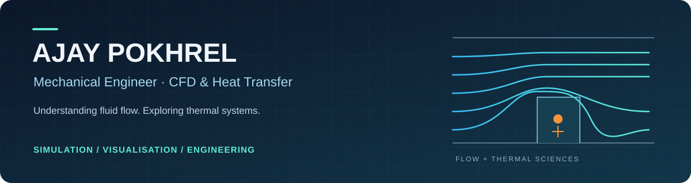

**[About me](#about-me) · [Projects](#selected-engineering-work) · [Tools](#tools--methods)**

## About me

I'm **Ajay Pokhrel, a mechanical engineer and educator based in Nepal**, with a particular interest in **computational fluid dynamics and heat transfer**. I enjoy connecting engineering fundamentals with practical questions: how a flow develops, how heat travels through a system, and how simulation can help us understand that behaviour.

I am a **mechanical engineering graduate of Tribhuvan University, Nepal**. My undergraduate thesis explored a **closed-loop pulsating heat pipe** in ANSYS Fluent using **VOF and Lee phase-change modelling**. My engineering interests centre on **thermal management, multiphase flow, and cooling systems**.

As a **Mechanical Engineering Instructor at Lahan Technical School, CTEVT**, I teach Fluid Mechanics, Thermal Engineering, and Hydraulics alongside practical engineering. My project work brings together **ANSYS Fluent, OpenFOAM, ParaView, Python, and Excel** for simulation, post-processing, and technical reporting. Here, I share the physical problems, methods, and results behind my work while continuing to develop my CFD and engineering-analysis skills.

> **My focus:** computational heat transfer, internal flows, multiphase CFD, and thermal-management applications, including battery cooling.

## Selected engineering work

<table>
<tr>
<td width="50%" valign="top">

### 01 / Heated obstacle in a channel
**ANSYS Fluent · Conjugate heat transfer**

Study of fluid–solid heat transfer during forced convective cooling, based on the Young & Vafai heated-obstacle problem.

**Inside:** Fluent case files, inlet-velocity UDF sources, Nusselt-number exports, Python plots, and reports.

[**View project →**](https://github.com/ajaypokhrel981/ansys-fluent-conjugate-heat-transfer) · [Figures](https://github.com/ajaypokhrel981/ansys-fluent-conjugate-heat-transfer/tree/main/results/figures)

</td>
<td width="50%" valign="top">

### 02 / Flow through a T-junction
**OpenFOAM · Turbulent internal flow**

Steady, incompressible flow through a 3D pipe junction with one inlet and two outlets, using the k–ω SST turbulence model.

**Inside:** STL geometry, mesh dictionaries, solver setup, run scripts, ParaView results, and execution logs.

[**View project →**](https://github.com/ajaypokhrel981/openfoam-t-junction-flow) · [Case files](https://github.com/ajaypokhrel981/openfoam-t-junction-flow/tree/main/case)

</td>
</tr>
</table>

Images show original coursework results. Verification status and remaining checks are documented below and in each repository.

<strong>Read project evidence and verification status</strong>

- **ANSYS Fluent:** preserved coursework archive. Differences between saved-case settings and report descriptions remain unresolved; benchmark validation has not been established by the repository review. Read the [verification notes](https://github.com/ajaypokhrel981/ansys-fluent-conjugate-heat-transfer/blob/main/docs/verification-notes.md).
- **OpenFOAM:** a rebuilt 183,378-cell mesh passed `checkMesh`, and the solver completed 500 iterations in OpenFOAM v2412. Convergence, physical accuracy, and mesh independence still require assessment. See the [verification logs](https://github.com/ajaypokhrel981/openfoam-t-junction-flow/tree/main/results/verification).
- Original results and later workflow checks are identified separately in the repositories.

### 03 / Pulsating heat pipe — undergraduate thesis
**ANSYS Fluent · Transient multiphase flow · Thermal management**

My undergraduate thesis focused on numerical modelling of a **closed-loop pulsating heat pipe** in ANSYS Fluent, using the **Volume of Fluid (VOF)** and **Lee phase-change** models for a thermal-management application.

Tribhuvan University · Research background; project files are not currently featured in this portfolio.

## Tools & methods

| Engineering activity | Tools & methods |
| :--- | :--- |
| **Flow & heat-transfer modelling** | ANSYS Fluent · Conjugate heat transfer · Internal flows · VOF · Lee phase-change modelling |
| **Meshing & numerical setup** | OpenFOAM `blockMesh` / `snappyHexMesh` · Boundary conditions · `simpleFoam` · k–ω SST |
| **Results & engineering data** | ParaView · Fluent visualisation · Python plotting · Excel calculations and charts |
| **Design & communication** | SolidWorks · AutoCAD · Technical reports · Engineering drawings and presentations |

**Continuing development:** I am strengthening my basic working knowledge of **OpenFOAM** and **Python**, with an emphasis on reliable post-processing, convergence assessment, and simulation verification and validation.

## Let's connect

I'm interested in exchanging ideas about **CFD, thermal systems, research, and engineering education**. You can find my professional background and connect with me on **[LinkedIn](https://www.linkedin.com/in/ajay-pokhrel-93aa83223/)**.

---

<strong>Understand the physics · Document the method · Keep learning</strong>

